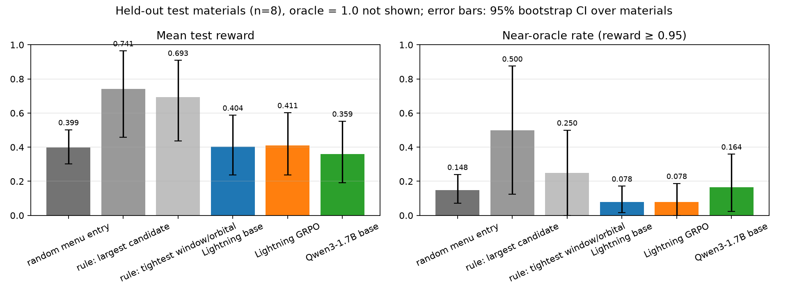

# Quantatron: teaching a language model to pick quantum-simulation active spaces

Built at the NVIDIA × Red Hat Small Models Hack (Raleigh, Oct 17–18 2026).

Simulating a material on a fault-tolerant quantum computer starts with choosing an **active space**: the handful of
orbitals that the expensive quantum algorithm treats exactly. A bigger active space recovers more of the correlation
energy (accuracy) but costs more Toffoli gates in quantum phase estimation (cost). This repo turns that judgment call
into a **verifiable, tool-calling RL task**:

- Each material comes with a fixed **menu of candidate active spaces**.
- An agent inspects the material and the menu through tools, then submits one candidate.
- A hidden verifier scores the pick by `accuracy − β·log10(Toffolis)`, normalized per material so the best candidate
  gets reward 1 and the worst gets 0.

The task is wrapped as a [NeMo Gym](https://github.com/NVIDIA-NeMo/Gym) environment. **Nemotron 3.5 Lightning**
(30B-A3B MoE) is trained on it with GRPO + LoRA in [NeMo RL](https://github.com/NVIDIA-NeMo/RL), with rollouts and
evaluation served by vLLM.

## Results

On 8 held-out materials from two chemical families never seen in training (transition-metal binary oxides and ionic
salts), 16 rollouts per material:

| Method | Mean test reward [95% CI] | Near-oracle rate | Valid answers |
| --- | --- | --- | --- |
| Random menu entry | 0.399 [0.303, 0.502] | 0.148 | 1.00 |
| Rule: largest candidate | **0.741** [0.459, 0.965] | 0.500 | 1.00 |
| Rule: tightest energy window per orbital | 0.693 [0.437, 0.909] | 0.250 | 1.00 |
| Nemotron 3.5 Lightning, base | 0.404 [0.238, 0.588] | 0.078 | 0.98 |
| Nemotron 3.5 Lightning, GRPO (v2 run) | 0.411 [0.238, 0.602] | 0.078 | 0.95 |
| Qwen3-1.7B, base | 0.359 [0.191, 0.553] | 0.164 | 0.87 |

The oracle scores 1.0 by construction. CIs are bootstrapped over materials. Near-oracle means reward ≥ 0.95.



**What this shows:**

- **GRPO did not measurably improve the model.** The test reward went from 0.404 to 0.411, well inside the base model's
  confidence interval. The training reward stayed flat at about 0.47 over 32 steps
  ([training curves](docs/figures/candidates_training_curves.png)). An earlier v1 run (20 steps, lower learning rate)
  gave the same picture: 0.389 → 0.421.
- **Neither model beats random by much, but a one-line rule does.** "Pick the largest candidate" scores 0.741. At
  β = 0.2 the spread in recovered correlation within a menu (~0.56) outweighs the spread in the cost term (~0.31), so
  bigger is usually better. The models show no overall size bias: their average pick sits at the same place in the
  menu as the oracle's, and they choose the largest candidate in 29–40% of answers. They lose on *which* materials
  they go big on.
- **The environment works.** Answers are almost always valid. The test split cannot leak into training. The base and
  trained models are served with identical settings. So the reward is a clean signal that a stronger setup (more
  steps, more materials, a reward shaped around the size trade-off) can be measured against.

Full table including majority votes: [`docs/results/candidates_test_table.md`](docs/results/candidates_test_table.md).
Per-material results: [`docs/figures/candidates_test_per_material.png`](docs/figures/candidates_test_per_material.png).

## Two environments

The repo has two environments for the same task. They share the tools, the reward and the verify-only scoring, but
differ in where the data comes from and how much the agent sees.

| | `active_space_candidates` (trained) | `active_space` (full pipeline) |
| --- | --- | --- |
| Data | Precomputed Phasecraft DZVP table ([`data/phasecraft_tables/`](data/phasecraft_tables/)) | Built here from scratch: PySCF RHF → localization → MP2 accuracy proxy → OpenFermion/Qualtran cost |
| Materials | 24 (16 train / 8 test) | 46 (27 train / 5 validation / 14 test with the fast SZV table) |
| Agent sees | Per-candidate summary: size, energy window, atomic character, log10 Toffoli cost | Per-orbital table: energies, occupations, atomic character |
| β | 0.2 (fixed by the table) | Chosen automatically to maximize the diversity of oracle sizes |
| Training | 2 GPUs (Brev, 2× A100 80GB), LoRA rank 32 | 8 GPUs, LoRA rank 64 |
| Status | Trained and evaluated (results above) | Table built and classical baselines evaluated; **no LLM training run yet** |
| Guide | [`docs/active_space_candidates.md`](docs/active_space_candidates.md) | [Full pipeline](#full-pipeline-active_space) below |

In both environments an episode looks the same. The agent calls `get_structure(material_id)` and
`get_orbitals(material_id, candidate_id)` to inspect the material and its menu, then
`submit_active_space(material_id, candidate_id)`. Tools never return a score. Only the first valid submission counts,
so recovering from a rejected call is rewarded but spraying answers is not.

## Repository layout

```text
active_space/                     Python package: PySCF pipeline, cost model, family splits, prompts for both envs
configs/                          PySCF pipeline settings (phase1.yaml: DZVP, phase1_fast.yaml: SZV)
data/
  raw/                            Phasecraft material list + CIFs (inputs to the full pipeline)
  work_fast/                      Per-material PySCF outputs of the fast SZV run
  phasecraft_tables/              Precomputed per-candidate tables (input to active_space_candidates)
resources_servers/
  active_space/                   NeMo Gym server, data and tests: full pipeline
  active_space_candidates/        NeMo Gym server, data and tests: candidate-level (trained)
scripts/
  01_fetch_materials.py … 06_plot_tcount.py, run_eval.sh    Full pipeline: build, evaluate, plot
  candidates/                     build_env_data, run_eval, evaluate, plot_results, compare_models, mock policy
training/
  configs/                        GRPO configs (full pipeline; candidates for Lightning and Qwen3)
  launch_grpo.sh, launch_grpo_candidates.sh, export_checkpoint.sh, convert_hf_to_megatron.py
serving/serve_vllm.sh             Red Hat AI Inference Server (vLLM) for the full pipeline
brev/run_on_brev.sh               One-command driver for the candidates experiment on an NVIDIA Brev GPU box
docs/                             Candidates guide, figures and result summaries
```

## Quickstart

```bash
# Environment tests (CPU, no model needed): both servers, data leakage, config shape
python3 -m venv .venv && .venv/bin/pip install -r requirements-gym.txt -r requirements-analysis.txt
.venv/bin/python -m pytest -q                                  # 15 passed
```

### Run the candidates experiment

The whole GPU side runs on one Brev box driven from your laptop. See
[`docs/active_space_candidates.md`](docs/active_space_candidates.md) for the step-by-step guide with expected outputs,
costs and troubleshooting.

```bash
brev login
bash brev/run_on_brev.sh up          # create the 2× A100 box (asks before billing)
bash brev/run_on_brev.sh setup       # containers, NeMo RL checkout, model weights
bash brev/run_on_brev.sh all         # baseline → GRPO (32 steps, ~4 h) → evaluate the trained model
bash brev/run_on_brev.sh pull        # rollouts + TensorBoard logs back to your laptop
bash brev/run_on_brev.sh down        # delete the box
uv run --with tensorboard --with matplotlib --with numpy python scripts/candidates/plot_results.py
```

### Run the full pipeline

```bash
# Phase 1: build the table (CPU; a many-core box helps)
python3 -m venv .venv-chem && .venv-chem/bin/pip install -r requirements-phase1.txt
.venv-chem/bin/python scripts/01_fetch_materials.py                 # ~1 min, keyless (MP_API_KEY optional)
.venv-chem/bin/python scripts/02_run_pyscf.py --jobs 8               # DZVP; resumable, per material
#   fast first pass (GTH-SZV, ~1 min/material on a laptop):
#   .venv-chem/bin/python scripts/02_run_pyscf.py --config configs/phase1_fast.yaml --jobs 4
.venv-chem/bin/python scripts/03_build_table.py [--config configs/phase1_fast.yaml]

# Phase 2: baseline (GPU). Red Hat vLLM needs `podman login registry.redhat.io` once.
cp env.yaml.example env.yaml
bash serving/serve_vllm.sh &                      # Nemotron 3.5 Lightning NVFP4, 1 GPU
TAG=base bash scripts/run_eval.sh                 # test split, 8 rollouts/material
.venv-chem/bin/python scripts/05_evaluate.py results/base_test.jsonl

# Phase 3: GRPO (8 GPUs), then evaluate the trained model the same way
NEMO_RL_DIR=~/RL bash training/launch_grpo.sh grpo.max_num_steps=2 grpo.num_prompts_per_step=2   # smoke
NEMO_RL_DIR=~/RL bash training/launch_grpo.sh
NEMO_RL_DIR=~/RL STEP=60 bash training/export_checkpoint.sh
MODEL=$PWD/checkpoints/lightning35-active-space-step60 TP=2 bash serving/serve_vllm.sh &
TAG=grpo bash scripts/run_eval.sh
.venv-chem/bin/python scripts/05_evaluate.py results/base_test.jsonl results/grpo_test.jsonl
```

## Full pipeline (`active_space`)

| Step | What | Where |
| --- | --- | --- |
| 1 | 46 Phasecraft materials → MP ids, Wannier counts, CIFs | `scripts/01_fetch_materials.py`, `active_space/sources.py` |
| 2 | PySCF `pbc` RHF (Γ point, fixed GTH basis/pseudo, supercell rule), Pipek–Mezey localization | `active_space/pipeline.py` |
| 3 | Fixed menu: `frontier` or `<El>-<nl>` selection × sizes 2–20, CAS(n,n) | `pipeline.make_menu` |
| 4 | Accuracy = active-space MP2 pair energy / total MP2 correlation (plus NO proxy, CASCI ≤ 12 orbitals). Cost = DF factorization + λ (OpenFermion) → Toffolis/step + logical qubits (Qualtran) × ⌈πλ/2ΔE⌉ | `pipeline.py`, `active_space/cost.py` |
| 5 | score = accuracy − β·log10(Toffolis); oracle = argmax; writes `scores.json` (verify-only) and `orbitals.json` (agent-visible) | `scripts/03_build_table.py`, `active_space/table.py` |
| 6 | Whole families held out (test: TM binary oxides, III-V/II-VI semiconductors, halide perovskites; validation: layered oxides) | `active_space/families.py`, `configs/phase1.yaml` |
| 7–9 | NeMo Gym server: prompt (structure + orbital table, no scores), tools, `verify()` = 0 if invalid/off-menu else (score − worst)/(best − worst) | `resources_servers/active_space/` |
| 10 | Baselines: untrained Lightning (Red Hat vLLM + Gym rollouts), AVAS-style projection, MP2 natural-orbital threshold, best fixed size, random | `serving/serve_vllm.sh`, `scripts/run_eval.sh`, `scripts/05_evaluate.py` |
| 11 | GRPO, 16 rollouts per material, LoRA on Megatron, 1 node × 8 GPUs | `training/` |
| 12 | Held-out mean reward, ≤5%-of-oracle rate, Spearman/MAE vs Phasecraft Wannier counts | `scripts/05_evaluate.py` |

**Status (fast GTH-SZV table).** All 46 materials ran and every SCF converged, giving 27 train / 5 validation / 14
test materials with 24–50 menu entries each. With auto β = 0.056, oracle sizes span 2–20 with 23 different
selections. Classical baselines on the held-out test families:

| Method | Mean reward | Within 5% of oracle | Spearman vs Wannier |
| --- | --- | --- | --- |
| Oracle | 1.000 | 1.000 | 0.65 |
| MP2 natural-orbital threshold | 0.416 | 0.000 | 0.58 |
| AVAS-style projection | 0.223 | 0.071 | 0.75 |
| Best fixed size on train (frontier:4) | 0.187 | 0.000 | 0.48 |
| Random menu entry | 0.296 | 0.055 | 0.67 |

LLM rows for this environment would come from `scripts/run_eval.sh` + `scripts/05_evaluate.py`; they have not been
run. For final numbers, re-run `02`/`03` with the default DZVP config on a bigger CPU box.

### Design decisions

- **One window serves every candidate.** All candidates are subsets of canonical RHF orbitals in a frontier window
  (≤ 30 occupied + 30 virtual). One window ERI tensor gives every candidate's active-space MP2 energy (restricted pair
  sums), its frozen-core Hamiltonian (h_eff = F_A − Σ_{i∈A_occ}[2(pq|ii) − (pi|iq)]) and therefore its DF cost, with
  no further integral work.
- **Cost model cross-check.** Qualtran's `DoubleFactorizationBlockEncoding` Toffolis per step agree with OpenFermion's
  `compute_cost` to about 1% for 6–20 orbitals. Both are stored. For tiny spaces (2–4 orbitals) both models break
  (QROM block size < 1), so the DF rank is padded until they apply; this is a mild upper bound, flagged as `rank_pad`
  in the work files.
- **β is chosen so the task is not trivial.** With a single fixed β, every oracle tends to be either the smallest
  space or the largest. `beta: auto` picks the β that maximizes the entropy of oracle sizes on the *train* split;
  `03_build_table.py` prints the sweep. Use `--beta 0.05` to fix it instead. Raw accuracies and costs are kept, so
  changing β never requires re-running PySCF. (The candidates environment inherits β = 0.2 from its table, and its
  results above show what happens when one size class dominates.)
- **Supercell rule.** The configured supercell (default 1×1×1) is doubled along its shortest axis until the electron
  count is even (closed-shell RHF) and there are ≥ 10 occupied orbitals (so every menu size fits). This is
  deterministic, so it is still a fixed protocol. Phasecraft agreement divides the chosen size by the number of cells.
- **Verify is the only place scores live**, and **the test split is not declared in the Gym config**, so it can never
  be collated into training data. Both environments follow these two rules, and their tests check them.

## Limitations

- **Small scale.** 16 training materials and 32 GRPO steps is a hackathon-scale run, not a converged result. The
  test CIs span about ±0.18 because there are only 8 test materials.
- **Cheap chemistry.** Γ-point RHF on small supercells with an MP2 accuracy proxy (full pipeline) is a cheap,
  internally consistent benchmark, not converged solid-state correlation. Metallic/magnetic cases (SrVO3, Fe2O3, CuO)
  are treated closed-shell; `scf_converged` and the gap are recorded per material.
- **Resolved material ids.** Phasecraft lists six materials without a usable MP id. They are resolved by formula,
  space group and atom count: GaAs → mp-2534, TiO2 → mp-1426806, YFeO3 → mp-1416093, YVO3 → mp-1504764 (exact
  matches); H3S → mp-1063581 (Im-3m, but 4 atoms vs Phasecraft's 26) and Li2CuO2 → mp-4711 (Immm vs Phasecraft's Cm).
  See `id_note` in `data/raw/phasecraft.json`.
- **AVAS approximation.** AVAS here is an AVAS-style projection onto meta-Löwdin AOs of the material's open d/f shell
  (PySCF's `mcscf.avas` needs an all-electron minimal basis, which clashes with GTH cores). Both classical baselines
  are mapped to the nearest menu entry.
- **La basis.** La has no GTH-MOLOPT basis in PySCF's default files. It uses DZVP-MOLOPT-SR from the bundled UCL
  file, read with our own CP2K parser (PySCF's parser mishandles multi-l sets).
- **Serving engine.** The candidates experiment was served with upstream `vllm/vllm-openai:v0.27.1` on Brev.
  `serving/serve_vllm.sh` (Red Hat AI Inference Server) is set up for the full pipeline but was not used for the
  results above.
- **Untested full-pipeline training.** The full pipeline's GRPO config inherits from a NeMo RL example and has not
  been run end to end. Its Gym config also declares an `environment_servers` entry, which the candidates environment
  found crashes training with the Gym pinned by NeMo RL v0.7.0. Split it into an eval-only config (as
  `active_space_candidates_eval.yaml` does) and run the 2-step smoke test before a full run.

## License

[MIT](LICENSE).
